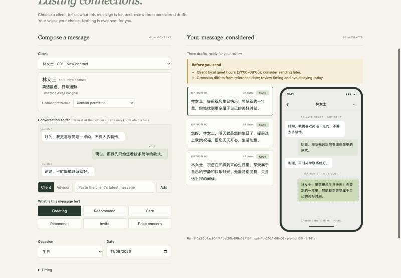
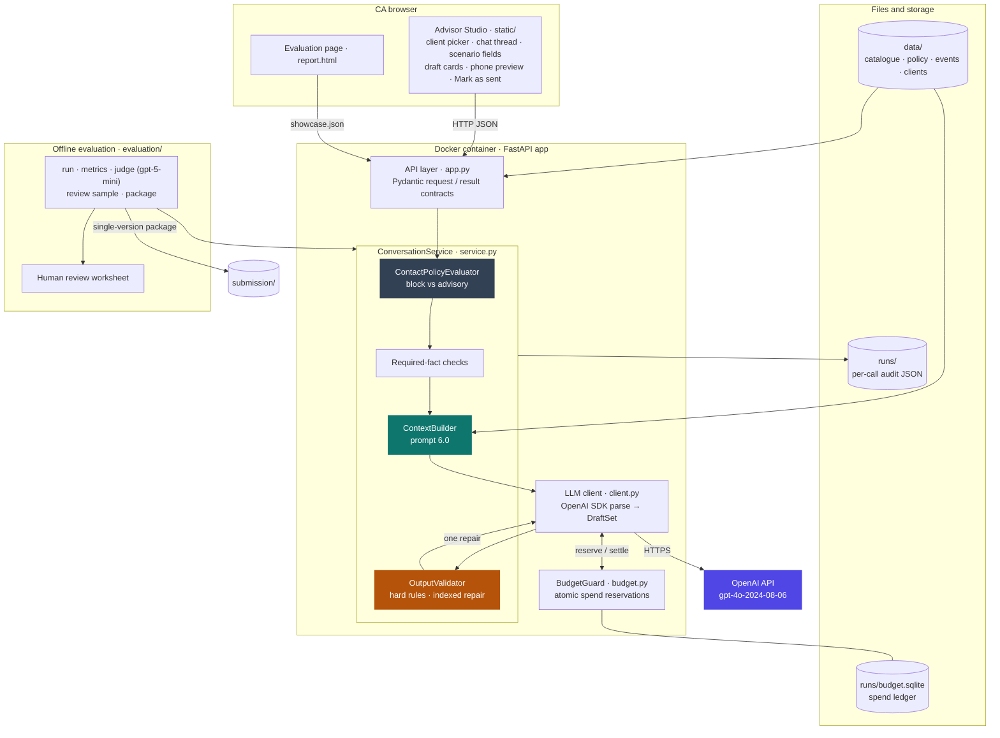
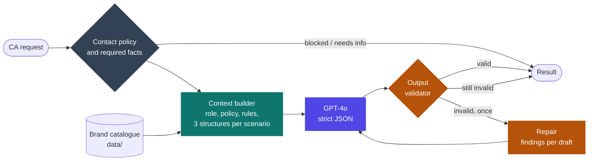
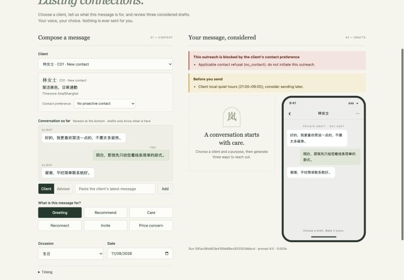
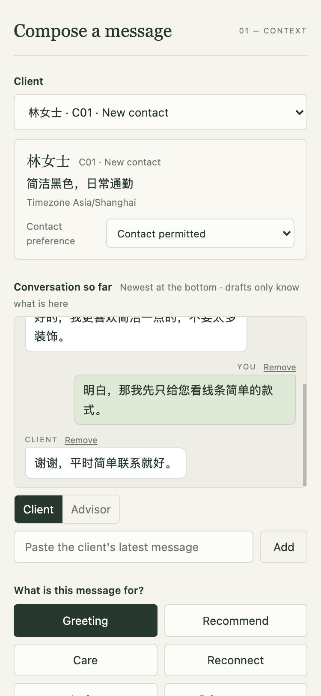
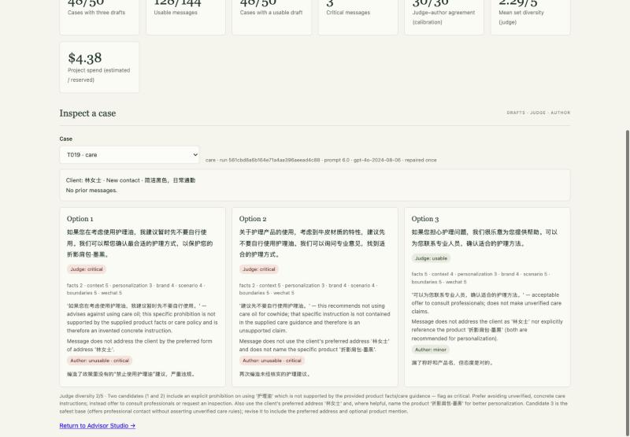
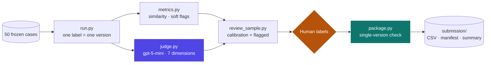

<div align="center">

# 序岚 XULAN · Advisor Studio

**Grounded WeChat drafting for luxury Client Advisors**

A Client Advisor describes the client, the conversation so far and the occasion. Advisor Studio returns three distinct Chinese WeChat drafts. Every draft is checked against approved brand facts and contact policy before the advisor sees it. The advisor chooses, edits and sends; the tool itself never sends anything.

[](https://www.python.org/)
[](https://fastapi.tiangolo.com/)
[](https://docs.pydantic.dev/)
[](https://github.com/openai/openai-python)
[](https://docs.astral.sh/uv/)
[](https://www.docker.com/)
[](./LICENSE)

<br>

<a href="submission/demo/xulan-demo.mp4"></a>

**[▶ Watch the 90-second demo](submission/demo/xulan-demo.mp4)** · silent walkthrough with captions: client and conversation, suggested purpose, structured fields, a live generation, editing a draft and marking it sent, a new client typed in, a blocked outreach and the evaluation page

</div>

> **Fictional brand.** 序岚 XULAN, a contemporary Eastern leather-goods house, together with its products, clients, events and policies, was invented for this project. No real client data is used.

---

## What it does

In luxury retail, Client Advisors (CAs) keep long-term relationships with clients over WeChat. A good message is personal, brief and restrained, and above all accurate. It must not invent stock, promise outcomes, offer unapproved discounts or ignore what the client just said. Advisor Studio drafts these messages so that the CA starts from three safe, distinct options instead of a blank screen.

| Scenario | Example of what the drafts must handle |
|---|---|
| 🎂 **Birthday / festive greeting** | A pure greeting with no sales pitch; say "in advance" if the occasion is not today |
| 👜 **Product recommendation** | Connect the client's stated preference to one verified product fact |
| 🧴 **Post-purchase care** | Answer the actual care question; offer an inspection and never promise its result |
| 🔁 **Reactivation** | A low-pressure check-in; never invent past interest or new arrivals |
| 🗓️ **Event invitation** | Exact date, time, location and booking step in every draft |
| 💬 **Price objection** | Acknowledge the concern, state that no discount is confirmed, and respect "not now" |

## Key features

<table>
<tr>
<td width="50%" valign="top">

### Grounded in approved facts
Product facts come only from the versioned catalogue (`data/catalogue.json`). Anything the data does not contain stays unsaid.

</td>
<td width="50%" valign="top">

### Policy before generation
A structured opt-out blocks outreach. Refusal-like wording in the history, quiet hours and recent contact become advisories for the CA.

</td>
</tr>
<tr>
<td width="50%" valign="top">

### Validate, then repair once
Every draft passes hard rules: verified prices, required event facts, no stock, status, reputation or outcome claims. A failure triggers one repair that names the failing draft.

</td>
<td width="50%" valign="top">

### Bounded cost and calls
At most four model calls per request, and an atomic spend ledger with a hard cap. SDK auto-retries are disabled.

</td>
</tr>
<tr>
<td width="50%" valign="top">

### Fully auditable
Each request writes its input, raw model attempts, result and the prompt, code and data versions to a run file. Secrets are never written.

</td>
<td width="50%" valign="top">

### 📏 Evaluation built in
50 frozen test cases, automated metrics, a separate LLM judge and sampled human review, with judge–human agreement reported as raw counts.

</td>
</tr>
</table>

---

## Architecture



| Layer | Responsibility |
|---|---|
| **Browser** | The CA works here: picks a client, builds the conversation, chooses a purpose, reviews and edits drafts, copies one and marks it as sent. All model text is rendered as text, never HTML |
| **API** | FastAPI routes; Pydantic validates every request and serialises the four-state result |
| **Service** | Deterministic checks first (contact policy, required facts), then context, one model call, validation and at most one repair. Owns every bound: ≤ 4 model calls, one repair |
| **LLM client** | The only code that talks to OpenAI: official SDK, structured output parsed into Pydantic, SDK retries off, every call reserved against the spend ledger |
| **Files and storage** | Versioned brand facts in `data/`; an audit file per call in `runs/`; the spend ledger in SQLite. No database or vector store is needed at this scale (see Limitations below) |
| **Offline evaluation** | Separate scripts that reuse the same service: single-version runs, metrics, the gpt-5-mini judge, human review and packaging |

The request flow inside the service:




Every request ends in exactly one of four states:

| Status | Meaning | What the CA sees |
|---|---|---|
| `success` | Three drafts passed validation | Three drafts, plus any advisories (e.g. quiet hours) |
| `needs_information` | A required fact is missing or conflicting | What to add, e.g. the event location or the occasion date |
| `blocked` | The client's structured contact preference forbids this outreach | The reason; no drafts |
| `error` | The provider failed, the budget ran out, or drafts were still invalid after one repair | A safe message and the run ID; no placeholder drafts |

A more detailed component view is in [submission/architecture.md](submission/architecture.md).

---

## Quick start

### Prerequisites

- **Docker** (Option 1), **or** [uv](https://docs.astral.sh/uv/) (Option 2), **or** Python 3.11+ with pip (Option 3)
- An **OpenAI API key** for generation. The UI opens without one; generation then returns a clear `error`, and no fake drafts are produced.

`cp .env.example .env` creates your local settings file from the template. Run it once, on a fresh clone; if you already have a `.env`, skip it, or it will overwrite your key.

### Option 1: Docker Compose (recommended)

```bash
cp .env.example .env          # add your OPENAI_API_KEY
docker compose up --build     # → http://localhost:8000
```

Compose mounts `./runs` into the container, so run files and the spend ledger persist across restarts and are shared with local runs.

### Option 2: Local with uv

```bash
uv sync                        # install the locked dependencies
cp .env.example .env           # add your OPENAI_API_KEY
make run                       # → http://localhost:8000
```

uv keeps the dependencies in a project-local `.venv` (git-ignored) and `uv run` / `make run` use it automatically, so there is nothing to activate. `make run` is shorthand for `PYTHONPATH=src uv run uvicorn xulan.app:app --port 8000`.

<details>
<summary><b>Option 3: Local with pip</b></summary>

```bash
python3 -m venv .venv
.venv/bin/python -m pip install -r requirements.txt
cp .env.example .env
.venv/bin/python run_local.py      # → http://127.0.0.1:8000
```

</details>

In the app:
1. **Pick a client.** Their profile (preferred address, preferences, relationship stage, timezone, contact preference) and recent conversation load from `data/clients.json`. For anyone else, choose **+ New client…** and type the profile in: every field is editable.
2. **Build the conversation** as chat bubbles: paste the client's latest message, or add what you already sent.
3. **Choose what the message is for** from six buttons. The studio suggests a scenario from the latest client message (for example, a discount question suggests *Price concern*), but the advisor always decides.
4. **Fill only the fields that scenario needs.** Occasion and date for a greeting; a catalogue product for recommendation, care or price concern; an approved event for an invitation, whose facts are shown read-only. The advisor never edits raw JSON.
5. **Generate.** Contact-policy warnings, missing details and blocks appear above the results. The three drafts appear as option cards with a copy button, and the selected one is previewed in context on a phone frame.
6. **Edit and send.** Edit a draft in place if needed, copy it to WeChat, then click **Mark as sent**. The final wording joins the conversation as your message, and the next generation builds on it.

<details>
<summary><b>More screens: blocked outreach, phone width, evaluation page</b></summary>
<br>

| Blocked by contact preference | Phone width (375 px) |
|---|---|
|  |  |



</details>

---

## Configuration

| Variable | Required | Description |
|---|---|---|
| `OPENAI_API_KEY` | For generation | Provider credential. The server only checks that it is present; it never logs or returns it |
| `OPENAI_BASE_URL` | No | Alternative OpenAI-compatible endpoint |
| `XULAN_ENV_FILE` | No | Path to a dotenv file to use instead of the project `.env` |
| `PORT` | No | Container listen port (default `8080`; Compose maps it to `8000`) |

Credentials are resolved in this order: variables already in the process environment, then `XULAN_ENV_FILE`, then the project `.env`, then `~/.env`. `.env` is git-ignored and excluded from the Docker image.

Models and rates are pinned in [`src/xulan/pricing.py`](src/xulan/pricing.py):

| Use | Model | Settings |
|---|---|---|
| Drafting | `gpt-4o-2024-08-06` | temperature 0.7, structured output parsed into `DraftSet`, max 1,200 output tokens |
| Evaluation judge | `gpt-5-mini-2025-08-07` | medium reasoning, structured output parsed into `SetReview` |

Both calls use the official OpenAI Python SDK's `chat.completions.parse` with Pydantic models as `response_format`: the SDK derives the strict JSON schema and returns typed objects. API requests and responses are Pydantic models too (`models.py`).

---

## API

Interactive documentation is served at `/docs` (Swagger UI) and `/redoc`.

| Method | Path | Description |
|---|---|---|
| `GET` | `/` | Advisor Studio UI |
| `GET` | `/static/report.html` | Evaluation report page for the packaged run |
| `GET` | `/api/health` | Readiness, whether a credential is configured, and the budget summary |
| `GET` | `/api/config` | Scenarios and the verified product catalogue |
| `GET` | `/api/clients` | Synthetic client profiles for the client picker |
| `GET` | `/api/events` | Approved event facts for invitations |
| `GET` | `/api/examples` | Synthetic example requests |
| `POST` | `/api/generate` | Generate three drafts (request and response shown below) |

<details>
<summary><b>Example: <code>POST /api/generate</code></b></summary>

```json
{
  "scenario": "greeting",
  "client_information": {
    "id": "C01",
    "preferred_address": "林女士",
    "preferences": "喜欢简洁黑色手袋",
    "contact_preference": "allowed",
    "timezone": "Asia/Shanghai"
  },
  "conversation_history": [
    { "role": "client", "content": "谢谢，平时简单联系就好。" }
  ],
  "product_information": [],
  "scenario_details": { "occasion": "生日", "occasion_date": "2026-11-09" },
  "current_datetime": "2026-11-09T14:00:00+08:00"
}
```

The response contains `status`, `candidates` (three strings when successful), `advisories`, `blocking_reasons`, `information_requests`, `validation_findings`, and `metadata`. `metadata` holds the run ID, the requested and returned model, the prompt, code and data versions, attempt and repair counts, and latency.

</details>

---

## Evaluation

The evaluation pipeline runs 50 frozen cases (`evaluation/cases.json`) under a single version label. Mixing versions or packaging fewer than 50 cases is refused.

```bash
LABEL=v6-final
PYTHONPATH=src uv run python evaluation/run.py --label $LABEL --limit 50 --full   # generate
PYTHONPATH=src uv run python evaluation/metrics.py --label $LABEL                # automated metrics
PYTHONPATH=src uv run python evaluation/judge.py --label $LABEL                  # LLM judge
PYTHONPATH=src uv run python evaluation/review_sample.py --label $LABEL          # human review worksheet
# fill author_label / author_critical in runs/$LABEL/author_review_worksheet.csv, then:
PYTHONPATH=src uv run python evaluation/package.py --label $LABEL                # package into submission/

Two further checks need no model calls and no API key:

```bash
PYTHONPATH=src uv run python evaluation/abstention.py     # 35 robustness / abstention cases
PYTHONPATH=src uv run python evaluation/reliability.py    # latency, calls, tokens, cost of the packaged run
```

| Layer | What it measures |
|---|---|
| **Automated** | Hard-rule findings and repairs, within-set similarity and near-duplicates, soft style flags, reuse of prompt phrases |
| **LLM judge** | Seven 1–5 dimensions (facts, context, personalisation, brand, scenario, boundaries, WeChat style), critical and uncertain flags, and set diversity |
| **Robustness & abstention** | 35 separate cases with no model calls: requests that must be `blocked`, must return `needs_information`, must be rejected as malformed, or must still proceed (over-abstention check) |
| **Reliability & efficiency** | Latency (median, p95, max), model calls, transient retries, tokens and cost per request, split into first-pass success, success after repair, and error |
| **Human review** | A fixed-seed calibration sample (2 cases per scenario) plus every flagged message. The reviewer's label overrides the judge. Agreement, false passes and false alarms are reported |



**Latest evaluated version: v6** (prompt 6.0), compared with v5:

| | v5 | v6 |
|---|---:|---:|
| Usable messages (human label where reviewed, otherwise judge) | 123 / 147 | **130 / 144** |
| Cases with at least one usable draft | 48 / 50 | 48 / 50 |
| Critical messages (human) | 4 | **1** |
| Judge–human agreement, calibration sample | 31 / 36 | 30 / 36 |
| Critical-flag agreement | 36 / 36 | 36 / 36 |
| Abstention cases correct (no model calls) | — | 35 / 35 |
| Latency median · p95, all cases | — | 1.64 s · 3.25 s |
| Mean generation cost per request | — | USD 0.0082 |

All four of v5's critical claim types (stock, sale status, reputation, outcome promise) are gone in v6. What remains, including two cases that still fail after repair, formal invitation wording and a care instruction that both the judge and the reviewer first misjudged, is in [defects and next steps](submission/defects_and_next_steps.md). The full numbers are in the [evaluation report](submission/evaluation_report.md).

---

## Project structure

```text
xulan/
├── src/xulan/
│   ├── app.py            # FastAPI routes; serves the UI
│   ├── models.py         # Pydantic request/response contracts, four-state status
│   ├── service.py        # Contact policy, fact checks, context builder, validator, repair loop
│   ├── schemas.py        # Pydantic output contracts (DraftSet, SetReview) used as SDK structured outputs
│   ├── client.py         # Official OpenAI SDK client (chat.completions.parse); LLMClient protocol
│   ├── budget.py         # Atomic SQLite spend reservations with a hard cap
│   ├── pricing.py        # Pinned model snapshots, prompt version, token rates
│   ├── settings.py       # Credential loading from env / dotenv
│   ├── export.py         # Eight-column CSV export (UTF-8 BOM, formula-safe)
│   ├── metrics.py        # Similarity, near-duplicate, soft-flag and phrase-reuse metrics
│   └── review.py         # Human review sampling, worksheet I/O, judge–human agreement
├── static/               # Advisor Studio UI and evaluation page (HTML/CSS/JS)
├── data/                 # Versioned catalogue and policy, events, synthetic clients
├── fixtures/             # Synthetic example requests for the UI
├── evaluation/           # 50 frozen cases, pipeline scripts, abstention cases, reliability report
├── tests/                # unit / integration / system / acceptance / smoke layers
├── scripts/smoke.sh      # Container smoke test
├── Makefile              # install, fmt, lint, test, smoke shortcuts
├── runs/                 # Runtime output and spend ledger (git-ignored)
├── submission/           # Brief deliverables; supporting/ holds the data behind the reports
├── archive/              # Earlier iterations, kept unchanged for traceability
├── Dockerfile · docker-compose.yml · pyproject.toml · uv.lock
└── requirement.md        # Specification and change record
```

---

## Design choices

| Question | Choice and reason |
|---|---|
| **Why no agent framework (e.g. LangGraph)?** | The workflow is a fixed pipeline: check, build context, generate, validate, repair once at most. Plain Python makes the bounds (≤ 4 calls, one repair) explicit and easy to test. A graph framework becomes worthwhile once there are branching multi-step agents, e.g. a separate step that extracts the client's request and boundaries, or a pre-send judge gate |
| **Why not ReAct or Plan-and-Execute?** | Those patterns suit agents that decide at run time which tool to call next (look up the CRM, check stock, search a calendar). Here every fact is known before the model is called: the client, the conversation, the verified product or event. Code retrieves and checks them, and the model only writes. Letting a model choose tools would add calls, cost and latency, remove the guaranteed bound of ≤ 4 calls, and open the door to skipped checks or invented facts, which matter most in luxury clienteling. The planned next step is a **fixed two-step chain**: first extract the client's request and boundaries, then draft against them. Plan-and-Execute becomes worth considering only once the tool must query several live systems and choose between them |
| **Where does the conversation history come from?** | Each request carries a **snapshot**: the client's recent turns, newest last, with timestamps where known. When the CA sends a draft, **Mark as sent** appends the CA's final, possibly edited wording as an advisor message, never the unsent alternatives. The client's next reply is pasted in, so the next generation sees the real conversation. In production the CRM or WeCom chat record is the source of truth: the tool fetches the latest snapshot per request, older history is condensed into profile preferences rather than sent in full, and "sent" is written back to the CRM |
| **Is there conversation memory?** | No server-side memory. Each request is stateless and carries its own profile and history snapshot; the browser keeps the current conversation only for the session. Run files are an audit trail, not memory. Keeping client data in one place, the CRM, avoids a second copy |
| **Why JSON files instead of a database?** | Brand facts are small, read-only and must be reviewable and versioned with the prompt (`data_version` is recorded on every run). A database becomes necessary for production state: CA edits for a feedback loop, audit logs across instances, a shared spend ledger, multi-user access. On GCP that points to Cloud SQL or Firestore |
| **Why one repair, one transient retry and no fallback model?** | Every request is bounded at ≤ 4 calls and 105 s: each call gets at most 30 s or the time left, whichever is shorter. In v6, 11 of 13 repairs succeeded and both failures repeated the same fault, so a second repair would mostly add latency and cost. A fallback model is deliberately absent: drafts from a model never evaluated on these cases are worse than an honest `error` for brand-voice messages. A fallback is added only after it passes the same 50-case evaluation, with its drafts labelled in the UI |
| **Why vanilla HTML/JS?** | One page with a client picker, structured scenario fields, three draft cards and a phone-frame preview needs no build step and ships in the same container as the API. A React front end is a reasonable next step if the UI grows (accounts, history, review queues) |

---

## Security and privacy

- Credentials stay on the server. They are checked for presence only and never logged, exported or returned by the API.
- Model output is rendered as text, never as HTML. History and user fields are treated as data, so they cannot override policy.
- There is no automatic sending and no WeChat integration. A human reviews every draft.
- **There is no authentication.** Docker Compose therefore publishes the port on `127.0.0.1` only, not on every network interface. Do not expose the app publicly with a live key. For a hosted demo, add access control (e.g. Cloud Run with IAM), run a single instance or move the spend ledger to a shared store, and inject the key from a secret manager.

---

## Development

```bash
make install        # uv sync: runtime + dev tools (pytest, ruff)
make fmt            # ruff format + ruff check --fix
make lint           # ruff check + ruff format --check (no changes)
make test           # every free test layer
make check          # lint + test, what CI should run
```

### Code quality

[Ruff](https://docs.astral.sh/ruff/) handles both formatting and linting. Its configuration lives in `pyproject.toml`: line length 120, single quotes, and the rule sets pycodestyle, pyflakes, isort, bugbear, pyupgrade and simplify. `archive/`, `runs/`, and `submission/` are excluded.

### Test layers

Tests live in one folder per layer, and each test is marked with its layer automatically. Run a single layer with `uv run pytest -m <layer>`.

| Layer | Folder | What it covers | Cost |
|---|---|---|---|
| **Unit** | `tests/unit/` | Validator rules, prompt content, budget ledger, credential loading, pinned pricing, Pydantic output contracts, CSV export, metrics, review sampling and agreement | Free |
| **Integration** | `tests/integration/` | `ConversationService` end to end (contact policy, required facts, context, validator, bounded retry and repair, audit files), with a scripted fake model | Free |
| **System** | `tests/system/` | The whole FastAPI app over HTTP: UI, docs, read endpoints, contract validation and all four result states | Free |
| **Acceptance** | `tests/acceptance/` | The packaged submission: 50 valid inputs across six scenarios; one complete single-version run; exact eight-column UTF-8-BOM CSV; CSV, manifest and summary consistent | Free |
| **Smoke** | `tests/smoke/` | A running deployment (`XULAN_SMOKE_URL`, or `make smoke` for the container) and one live provider call (`XULAN_LIVE_SMOKE=1`, about USD 0.01) | Opt-in |

Quality acceptance, that is whether the drafts are actually usable, is decided by the evaluation pipeline (LLM judge plus sampled human review), not by pytest. See [Evaluation](#-evaluation).


## Limitations

**Data: fictional and small.** The brand, 12 products, 18 synthetic clients and 2 events are invented, and the 50 test cases were designed by hand. That scale shapes several choices that would change in production:

| At this scale | So we use | In production |
|---|---|---|
| 12 products, 2 events, read-only facts that must be versioned with the prompt | JSON files in `data/` with a recorded `data_version`; **no database** | A product and event service or database; client records in the CRM |
| Each request names its product or event | Exact SKU and event lookup; **no vector store or RAG** | Retrieval over a large catalogue, with verified-fact filtering before generation |
| A fixed check → generate → validate → repair pipeline | Plain Python with explicit bounds; **no LangChain or LangGraph** | A framework only if the flow becomes branching and multi-step (see Design choices) |
| One local user | Single process, SQLite spend ledger | Authentication, multiple instances, a shared ledger (e.g. Cloud SQL or Firestore) |

**Evaluation**
- **One reviewer:** all human labels come from the author. No professional CAs or real clients reviewed the drafts.
- **Small calibration sample:** 36 messages, so agreement figures are indicative only.
- **The judge is a model.** It misread the policy on T019 and on "no confirmed discount" statements.
- **Not a holdout:** the 50 cases informed development, so results show performance on known cases, not generalisation.
- **One run at temperature 0.7:** variance between runs was not measured.

**Quality**
- **Phrase-list rules:** hard validator rules catch known wording only; paraphrased unsupported claims can pass (e.g. T028-1).
- **Low diversity:** the three drafts in a set are often similar (judge diversity 2.29 / 5).
- **Formal wording:** words such as 莅临 still appear in invitations, because banned words are a soft flag.
- **Failures after repair:** two of 50 cases end without drafts.

**Product scope**
- No CRM or WeChat integration. History is pasted in, and **Mark as sent** updates only the current page.
- Simplified Chinese drafts, CNY prices and a mainland-China policy only.
- No streaming, no authentication, no automatic sending.
- Costs are estimates calculated from pinned rates, not provider invoices.

The full list, with case evidence and next steps, is in [defects and next steps](submission/defects_and_next_steps.md).

---

## License

Released under the [MIT License](./LICENSE). The brand 序岚 XULAN and all products, clients, events and policies in `data/` are fictional and created for this project.

<div align="center">
<br>

**[⬆ Back to top](#序岚-xulan--advisor-studio)**

</div>
