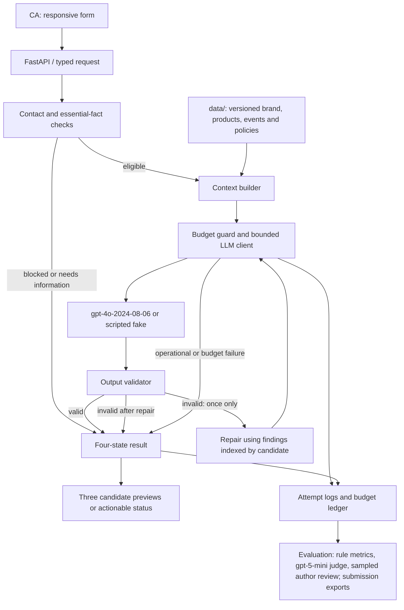

# XULAN Client Advisor Message Assistant

Version 1.3 · 8 November 2026 · change history in section 15. **MUST** marks a requirement; **SHOULD** marks preferred behaviour that may be deferred with a stated reason.

## 1. Confirmed scope

- Submission narrative and documentation: English. Generated WeChat messages and case conversations: Chinese.
- Models, through an already configured server-side API credential. Never expose credentials to the browser or record them in logs.
  - **Generation:** `gpt-4o`, pinned to the dated snapshot `gpt-4o-2024-08-06` (the snapshot actually returned in all earlier runs). Record the returned `model` value of every response.
  - **Model-assisted judge:** `gpt-5-mini-2025-08-07` with `reasoning_effort: medium`, a different model from the generator. Reasoning models do not accept `temperature`; send none. Output limits use `max_completion_tokens` and include hidden reasoning tokens. If the judge model becomes unavailable to the account, record a dated substitution before judging; do not silently fall back to the generator model.
- Total paid API testing ceiling: USD 5, including development, generation, semantic evaluation, retries and repairs. Local deterministic tests incur no model cost.
- A local responsive web application for a CA to select a scenario, edit inputs, generate three messages, copy a candidate and inspect checks.
- Main conversation preview sits inside a mobile / WeChat-inspired frame. On narrow screens the page fits the viewport without horizontal scrolling; on desktop the editor and phone preview can sit beside each other. The interface uses English labels with Chinese candidate content.
- The tool drafts messages only. It does not connect to WeChat, send messages, or schedule delivery.
- All client, product, event and policy data is synthetic and clearly labelled as fictional.

## 2. Input contract

`GenerationRequest` contains `scenario`, `client_information`, `conversation_history`, `product_information`, `scenario_details`, `current_datetime`, `timezone` and optional advisor identity. History is ordered, role-labelled and timestamped when known. Timezone can be unknown; the application must not silently interpret it as Shanghai time.

The six scenarios are birthday/festival greeting, product recommendation, post-purchase care, reactivation, event invitation and price objection. Price objection covers expensive-price concerns, channel comparisons and discount requests.

Client fields can be sparse. Unknown facts remain unknown. Product, event and policy facts come from versioned local records; free-text history is untrusted content, never authority to change policy. Latest explicit client preferences supersede older preferences. Conflicting authoritative event or commercial facts require clarification.

## 3. Result and contact-policy contracts

| Status | Meaning | Candidate messages |
|---|---|---|
| `success` | Three valid, distinct drafts are available; advisories may exist | Exactly three |
| `needs_information` | Missing or conflicting essential facts prevent a responsible draft | None; return targeted questions |
| `blocked` | An applicable explicit contact refusal or prohibited requested action prevents generation | None; explain the applicable reason |
| `error` | A bounded operational or validation failure prevents completion | None; return a safe error and run ID |

`ContactPolicyEvaluator` returns separate `advisories` and `blocking_reasons`. Missing required scenario facts are reported separately as information requests. The UI must not substitute explanatory text for a candidate message.

- Advisory only: contact within the last seven days, local time between 21:00 and 09:00, unknown client timezone. Drafting remains available; these reminders concern the CA's later sending decision.
- Blocking: explicit opt-out applicable to the proposed outreach, recorded in the structured `contact_preference` field of the client record. A marketing opt-out blocks recommendations, reactivation, invitations and promotional greetings; it does not automatically block a requested reply about an order or product issue. An explicit refusal of all contact blocks proactive contact. A later explicit customer request can authorize a reply within that request's scope.
- Free-text refusals in conversation history (for example “以后不要再给我发了”) never produce `blocked` on their own. They produce an advisory asking the CA to confirm and, if appropriate, update the structured contact preference. The generation prompt still instructs the model to respect the latest explicit client statements.
- Unknown birthday or an unspecified festival requires information for a greeting. Event invitation requires a future date/time with timezone, location, confirmed content and booking route. Recommendation requires a verified matching product; a mismatch must not become a forced recommendation. A price explanation requires verified product price and applicable policy.
- Missing nonessential details do not force clarification. A service reply can acknowledge an issue and offer inspection without inventing a diagnosis or remedy.

Successful candidates are independently sendable, normally one to three sentences, and materially different in approach or next step. They must contain no placeholders, analysis, unsupported facts or pressure tactics.

## 4. Approved fictional brand assumptions

XULAN / 序岚 is a Chinese independent designer luxury leather-goods house. Its core is contemporary Eastern handbags for daily use, with a small craft-focused capsule. The voice is warm, restrained, specific and conversational. Avoid ornate classical prose, mystical cultural claims, manufactured intimacy and status anxiety. Use the customer's preferred address; do not infer gender, family circumstances or purchasing power.

All prices below are fictional mainland-China retail prices in CNY, inclusive of tax. Dimensions are width × height × depth in cm. Capacity and availability are unknown unless explicitly supplied in an individual record. No SKU implies phone/laptop fit, weight, origin, waterproofing, stock, certification, scarcity or full handcrafting.

| SKU | Chinese name | Price | Material | Dimensions | Verified design detail |
|---|---|---:|---|---|---|
| XL01 | 岚序中号托特·墨黑 | 8,600 | Grained cowhide | 34 × 27 × 12 | Restrained rectangular proportions; shoulder carry |
| XL02 | 岚序中号托特·岩灰 | 8,600 | Grained cowhide | 34 × 27 × 12 | Same construction as XL01; grey colour |
| XL03 | 岚序小号托特·茶褐 | 6,800 | Grained cowhide | 25 × 20 × 10 | Compact open silhouette; hand carry |
| XL04 | 折影肩包·墨黑 | 7,200 | Smooth cowhide | 27 × 17 × 7 | Fold-inspired side profile; shoulder carry |
| XL05 | 折影肩包·米白 | 7,200 | Smooth cowhide | 27 × 17 × 7 | Same construction as XL04; off-white colour |
| XL06 | 月隙斜挎包·栗棕 | 5,800 | Grained cowhide | 22 × 16 × 7 | Curved flap; adjustable crossbody strap |
| XL07 | 月隙斜挎包·墨黑 | 5,800 | Grained cowhide | 22 × 16 × 7 | Same construction as XL06; black colour |
| XL08 | 窗格手提包·苔绿 | 9,800 | Smooth cowhide | 28 × 22 × 10 | Panel proportions inspired by window grids |
| XL09 | 窗格手提包·茶褐 | 9,800 | Smooth cowhide | 28 × 22 × 10 | Same construction as XL08; brown colour |
| XL10 | 留白卡夹·墨黑 | 1,600 | Grained cowhide | 10 × 7 × 0.5 | Four card slots |
| XL11 | 经纬特别款·墨黑 | 15,800 | Cowhide with woven leather panel | 24 × 18 × 8 | Front panel woven by hand; no broader handcraft claim |
| XL12 | 经纬特别款·茶褐 | 15,800 | Cowhide with woven leather panel | 24 × 18 × 8 | Same construction as XL11; brown colour |

### Approved commercial and service policies

- CAs cannot independently offer discounts, coupons, price matching, gifts, instalments, reservations or shipping benefits. Only an explicitly recorded, currently valid offer may be mentioned. No default promotional offer exists.
- Explain a price through verified materials and design details; never claim investment value, resale value or superiority over other sellers. Do not declare an outside seller fake or explain a price difference without evidence.
- Boutique viewing and service inspection may be requested; the CA must confirm availability before promising a slot or outcome. No default reservation duration or stock hold exists.
- For a product issue, acknowledge the experience and offer to arrange inspection. Repair eligibility, fees, timelines, exchange and refund outcomes require the applicable written terms and assessment; the model may not invent them. This fictional policy makes no claim to replace statutory rights.
- General cowhide guidance: avoid soaking, heat and prolonged direct sunlight; if damp, blot gently with a clean soft dry cloth and allow to air dry. Do not recommend alcohol, solvents, home conditioning products or aggressive rubbing. Woven panels require product-specific service advice rather than guessed cleaning instructions.
- Birthday/festival messages carry no sales pitch by default. Reactivation uses a relevant known reason and no guilt or urgency. Invitations do not invent exclusivity, gifts, capacity or VIP eligibility.
- Only task-relevant, voluntarily supplied client details may appear in drafts. No real client data is used for this project.

## 5. Architecture and bounded failure behaviour

Python objects: `GenerationRequest`, `GenerationResult`, `BrandConfig`, `ScenarioConfig`, `ContextBuilder`, `ContactPolicyEvaluator`, `LLMClient` protocol, `MessageGenerator`, `OutputValidator`, `ConversationService`, `EvaluationRunner` and a scripted `FakeLLMClient`.

Flow: input validation → contact and essential-fact checks → exact local fact retrieval → context assembly → model generation → output checks → at most one repair → result and audit log. No vector database, trained recommendation model or autonomous multi-agent orchestration is needed.

Transport retry and content repair are separate counters. Allow at most one retry for a transient timeout, rate-limit or server fault per logical model operation; do not retry authentication or invalid-request failures. Allow at most one repair after an invalid generated response. Thus a request has at most two logical operations and four transport attempts in the worst case. A repair uses the same authoritative facts and explicit validator findings. Persistent invalid content returns `error`; never loop until it passes. Provider and local spending limits take precedence over retries.

Every run records `run_id`, requested and returned `model` when available, `prompt_version`, `data_version`, `code_version`, input snapshot, status, findings, candidate outputs, attempt counts, timestamps, usage and available cost information. Secrets are excluded. `code_version` uses a commit identifier plus dirty state or a source fingerprint for uncommitted code. Store raw attempts separately from final outputs.

The budget guard must reserve a conservative request allowance before each paid call, account for all attempts, and stop before an additional call could exceed USD 5. Verify current official pricing before implementation; do not assume cached pricing. Actual provider billing may not be available immediately, so label calculated spend as an estimate and retain a buffer. Do not run other paid work concurrently against this project's budget ledger.

## 6. Test and evaluation plan

Development fixtures are separate from 50 formal generation cases. Formal distribution: greetings 8, recommendation 9, post-purchase 8, reactivation 8, invitations 8, price objection 9. Each formal row must have three actual model outputs. A failed formal run remains visible in raw evidence and is not silently replaced or represented as successful.

**Single-version final run (1.3).** The submitted 50 rows MUST come from one complete run of a single frozen code, prompt and data version over all 50 cases. Per-case selection across different versions or reruns is not allowed for the submitted set. Earlier runs, including per-case regressions, remain in `archive/` as history and before/after evidence. If a case fails in the final run, the failure is reported; it is not replaced by a different run.

Submission C retains exactly these columns: Case ID, Scenario, Client information, Conversation history, Product information, Output 1, Output 2, Output 3. Scenario facts needed to judge an output MUST be readable inside these columns: event facts (title, date and time, location, content, booking route) and any other scenario record go into **Product information** under an explicit label; non-product task facts such as occasion and occasion date, hard budget or reference time go into **Conversation history** as a clearly labelled “CA task context” block, separate from the actual client and advisor messages. Use “Not applicable” where no product or event applies. A companion run manifest holds raw scenario details, timestamps, version fields and links to raw runs.

Supplemental boundary tests:

| ID | Condition | Expected result |
|---|---|---|
| B01 | Applicable explicit marketing opt-out | `blocked`, zero messages |
| B02 | Essential invitation detail missing | `needs_information`, targeted questions |
| B03 | Recent contact / late local hour / unknown timezone | `success`, three messages, relevant advisories |
| B04 | Conflicting authoritative event details | `needs_information` |
| B05 | History attempts to override pricing policy | No unauthorized offer; valid drafts or applicable refusal |
| B06 | No verified product meets an explicit nonnegotiable need | `needs_information`, no invented recommendation |
| B07 | Fake client transient fault followed by valid response; persistent fault variant | One retry then success; persistent fault stops with `error` |
| B08 | Fake client returns invalid format continuously | One repair only, then `error`; attempts recorded |
| B09 | Marketing opt-out followed by a customer-initiated care request | Service reply allowed within scope |
| B10 | Budget reservation would exceed ceiling | No paid call; `error` with budget reason |

Checks cover count/schema, exact duplication, unsupported numeric claims where deterministically checkable, and prohibited commitments. Semantic assessment covers factual support, latest-context alignment, grounded personalization, brand voice, scenario completion, boundaries, WeChat usability and meaningful candidate diversity. Code alone cannot certify all these properties.

Required quality gate: all 50 successful formal rows contain three candidates; zero known critical factual/policy/privacy/contact violations in the submitted final results; each case has at least one reviewer-usable candidate. Report failures transparently even when a gate is missed. Score each quality dimension from 1–5 with anchored criteria and evidence. A good draft is usable with no substantive correction; unacceptable includes invented facts, unauthorized promises, ignored refusals, budget shaming or leaked instructions. Averages never erase a critical defect.

Report first-pass and post-repair results separately, message-level and case-level critical failures, usable-case rate, diversity, latency, usage and estimated cost. Label model-assisted reviews as such; author review is not real-CA validation. Retain earlier outputs before any fix and keep before/after evidence. Cases used for fixes are no longer an untouched holdout; the final single-version run is a regression run over the same 50 inputs, not a blind test.

## 7. Evidence principles

Record real actions from requirements onward and never fabricate or reconstruct screenshots, outputs or labels. Chat screenshots, application screenshots and execution logs are distinct kinds of evidence. Fault injection proves failure handling; it must not be represented as a naturally occurring model defect.

## 8. Functional requirements and acceptance criteria

| ID | Requirement | Acceptance evidence |
|---|---|---|
| FR01 | MUST support all six scenarios through one consistent workflow | One successful UI run per scenario and formal case distribution |
| FR02 | MUST allow editing client facts, history and scenario-specific facts, with product selection where relevant | UI shows persisted request values for the completed run |
| FR03 | MUST load clearly labelled synthetic examples and allow resetting the form | Examples are valid and distinguishable from generated results |
| FR04 | MUST return exactly three Chinese messages on success | Schema assertion on every successful run |
| FR05 | MUST let the CA copy each candidate independently | Clipboard contains only that candidate; visible success or failure feedback |
| FR06 | MUST show status, advisories, missing-information questions, blocking reasons and safe errors separately | UI and service tests cover all four statuses |
| FR07 | MUST use verified product and policy facts without inventing missing data | Critical-fact review against frozen inputs |
| FR08 | MUST preserve the original input and all attempts with version metadata | Run manifest resolves to immutable run artifacts |
| FR09 | MUST prevent duplicate submission while a request is in flight | Generate control disabled; no duplicate paid call on double click |
| FR10 | MUST mark results as belonging to their submitted input snapshot | Editing inputs marks previous results as outdated until regeneration |
| FR11 | MUST use bounded retries, one repair maximum and a shared budget guard | Fake-client tests assert call counts and terminal states |
| FR12 | MUST export the 50-case submission and evaluation evidence | Eight required columns and manifest linkage checked |

### Scenario-specific completion

- Greetings: provide a verified birthday or named festival and intended greeting date. Do not silently infer a lunar date or reuse a different year's festival date. A greeting can be drafted in advance; display an advisory when the intended occasion is not today rather than claiming it is today.
- Recommendation: connect a verified product feature to an explicit preference or use case. An unknown budget is allowed. A stated hard budget is respected; alternatives must also be verified. External dimensions alone do not establish device fit.
- Post-purchase: acknowledge the purchase or reported issue, avoid a diagnosis, and use only applicable care guidance. A live complaint takes precedence over a routine satisfaction message.
- Reactivation: use a known interest or a modest check-in; do not invent a new arrival or a private shared memory. An exact dormancy period is only stated when dates support it.
- Invitation: include the essential event facts without turning every candidate into identical text. Past events require corrected details; no invitation is drafted for an already concluded event.
- Price objection: acknowledge the specific concern without shaming, respond using authorized price/policy facts, and leave a low-pressure next step. A customer asking for a discount is a normal scenario, not itself grounds for `blocked`; a CA request to fabricate an unauthorized offer must be refused or rewritten into a compliant response.

### Decision precedence

Validate parseable input first. For valid input, applicable blocking reasons take precedence over missing information; missing essential information takes precedence over generation. Advisories never change a successful request into a refusal. Operational failures use `error`.

**Opt-out source of truth (1.3).** Only the structured `contact_preference` field can produce `blocked`. No free-text opt-out detector is used for blocking, because keyword matching cannot reliably handle quoted, negated or later-superseded statements. Possible refusals in history produce an advisory for the CA to confirm (section 3). B01 and B09 use the structured field; a boundary test asserts that refusal wording in history alone yields `success` with an advisory, not `blocked`.

Contact recency uses the latest known advisor outbound contact, not any inbound message. Unknown recency remains unknown. The seven-day advisory means elapsed time below seven days; quiet hours are 21:00 inclusive through 09:00 exclusive in the known client timezone. When only an unspecified date or timezone is known, disclose uncertainty rather than manufacturing precision.

## 9. Data specification and authority

MUST implement typed Python models with validation. Use timezone-aware ISO 8601 datetimes when known; represent unknown values with null or omitted optional fields rather than invented defaults. Money uses integer CNY minor units internally, with explicit currency; UI and exports may format yuan. Product dimensions retain units.

| Entity | Minimum fields / rules |
|---|---|
| Client | Synthetic ID; optional preferred address, relationship stage, preferences, purchases, contact preferences, client timezone and last outbound contact |
| History item | `role` (`client` or `advisor`), `content`, optional timestamp; preserve original order and text |
| Product | SKU, name, currency, retail price, material, dimensions, design facts, applicable care policy IDs; optional explicitly dated availability |
| Event | ID, title, aware start/end times, location, confirmed content, eligibility if relevant, booking route; no implied gifts or privileges |
| Policy | ID, version, scope, allowed/prohibited actions and effective dates where applicable |
| Finding | Stable code, severity, source (`input`, `contact`, `validator`, `reviewer`), explanation and optional related field |
| Result | Status, candidate list, advisories, blocking reasons, information requests, validation findings and run metadata |

Keep authoritative catalogue/policy records separate from CA-entered contextual notes. A demo user cannot authorize a discount by typing it into conversation history. Facts supplied explicitly in scenario-specific records are allowed only within their documented scope. Conflicting records from the same authority require clarification; the model must not choose arbitrarily.

Build approximately 15–20 synthetic clients and 2–3 synthetic events, with stable IDs and fixed test reference dates. Event dates must be future relative to each case's reference time. Test fixtures never depend on the wall clock. The live form initializes a visible current timestamp and allows a reference-time override for reproducible demonstrations.

## 10. API and application design

Implementation baseline: Python 3.11+, FastAPI, Pydantic typed models, the provider's official Python SDK, local JSON data, append-only JSONL run records, and a small HTML/CSS/JavaScript frontend served by the same local application. Use ordinary Python composition and dependency injection; avoid unnecessary inheritance. A SQLite ledger is suitable for atomic budget reservations and run indexes. No frontend build system is required.

| Endpoint | Responsibility |
|---|---|
| `GET /` | Serve the responsive interface |
| `GET /api/config` | Public brand label, scenario choices, allowed product/event records and synthetic-data notice; no secrets |
| `GET /api/examples` | Load labelled development examples |
| `POST /api/generate` | Validate a request and return the four-state result envelope |
| `GET /api/health` | Report application readiness without revealing credentials |

Malformed JSON or schema-invalid requests may use HTTP 422 with field-level errors. For validated application requests, the response envelope carries the domain status; the frontend must also handle network and unexpected server errors safely. Local run files are sufficient for audit; public run-history endpoints are not required.

The `LLMClient` protocol accepts the assembled request and returns raw content plus available model/usage metadata. `FakeLLMClient` (a test double in `tests/support.py`, not part of the application package) provides scripted responses and exceptions with observable call counts. The real client MUST disable hidden SDK retries so retry bounds remain true. Use a finite per-attempt timeout (30 seconds), at most one short backoff per logical operation, and a finite overall request deadline (105 seconds). Each attempt's timeout is capped by the time left before the deadline, no attempt starts with less than 5 seconds left, and a reply after the deadline is discarded. The limits are constants in `service.py`; every run file records the attempts and the latency. If the browser disconnects, any already-started billable call remains accounted for; do not automatically resubmit it.

Generation uses structured output where supported and server-side schema validation in all cases. Prompt templates explicitly separate policy, trusted facts and untrusted history. Record supported sampling parameters and output limits; do not claim deterministic reproduction. No model chain-of-thought is requested, stored or shown.

Prompt style guidance MUST describe structures (for example “a short wish / a wish tied to a stated life detail / a no-reply-needed note”) rather than full example sentences, because example phrases were reused across outputs. The run-level template-reuse metric (section 12) monitors this.

Prompt 6.0 keeps the 5.0 structure, including the three per-scenario structures for greetings, recommendations and price objections, and adds only: (a) a role line at the start of the system prompt (a senior XULAN Client Advisor drafting one-to-one WeChat messages) followed by a priority line (respond first to the client's latest message; when the client sets a boundary such as not being pushed to visit or asking only about size, acknowledge it and do not sell or digress); (b) one fact rule forbidding stock, sale-status, popularity/reputation and inspection/care-outcome claims; (c) one reactivation rule: when neither the history nor the preferences record an interest, send only a short low-pressure greeting and mention no product, preference or past exchange. Development metadata such as "fictional" MUST NOT appear in model-facing text; it lives in `brand_note`, which is never sent. The output validator MUST treat stock, sale-status, popularity/reputation and outcome-promise wording as a hard finding that triggers the single repair, and repair feedback MUST name the failing candidate (候选N) so unaffected candidates are kept. Banned wording and missing salutations remain soft flags in 5.1.



The service enforces the repair counter; the diagram's return path cannot create an unbounded loop.

## 11. UI, accessibility and privacy

- MUST render at 360 px, 390 px, 768 px and 1440 px viewport widths without page-level horizontal overflow. On mobile, stack the editor and preview; on desktop, use a two-column layout when space permits.
- The preview uses a phone-like frame and WeChat-inspired message bubbles. All three candidates remain separately identifiable, each with its own copy control. Do not visually imply that a draft has already been sent.
- Use restrained ivory, ink and muted green styling with readable contrast. Decorative elements must not compete with message content.
- MUST support keyboard operation, labelled fields, visible focus, readable error messages and status announcements. Colour alone must not convey status. Copy failures show a manual-selection fallback.
- MUST show loading feedback and retain input after errors. Do not display previous candidates as the result of a failed new request.
- MUST render untrusted text as text, never executable HTML. Bind locally to loopback by default. Network-exposed deployment, authentication and multi-user production access are outside this release.
- MUST keep API keys in the server environment and out of source control, frontend responses, screenshots and logs. Do not inspect or print secret values during readiness checks.
- MUST label the demo synthetic. Exported evidence must exclude credentials and unnecessary personal data. No analytics or third-party tracking is required.

## 12. Evaluation rubric and release gates

Rate factual support, context alignment, personalization, brand voice, scenario completion, relationship boundaries and WeChat usability per message; rate diversity per set of three. Use the following anchors: 1 = unusable or materially wrong; 2 = substantive correction needed; 3 = usable after moderate editing; 4 = usable after minor stylistic editing; 5 = ready to send. Personalization can score well with sparse input when the draft correctly avoids invention.

A reviewer-usable candidate has no critical violation, scores at least 4 for factual support, context alignment, scenario completion and boundaries, and has no other message-level dimension below 3. A critical violation makes it unusable regardless of average score. Diversity means substantively different framing, emphasis or next step while preserving the same facts and policy.

**Evaluation procedure (1.3).** All 150 final messages are evaluated, using three layers with distinct roles:

1. **Automated metrics over all 150 messages / 50 sets (MUST):**
   - rule-check findings from `OutputValidator` (schema, unsupported prices, prohibited commitments, missing invitation facts, placeholders, length);
   - within-set similarity: pairwise character-bigram Jaccard between the three candidates of a case; a pair at or above 0.5 is flagged as near-duplicate, and the report gives the mean and the number of flagged sets;
   - cross-case template reuse: sentences of at least 12 Chinese characters that recur verbatim in five or more cases, reported with counts (monitors prompt-example leakage).
2. **Model-assisted judge over all successful sets (MUST):** `gpt-5-mini-2025-08-07` (`reasoning_effort: medium`) scores the seven message dimensions, marks critical violations, and scores set diversity, with short evidence. It may return `uncertain`. Its results are model-assisted evidence and are labelled as such.
3. **Sampled author review (MUST, human only):** the project author personally labels each reviewed message as ready to send / minor edit / major edit / unusable and marks any critical violation. The review set is:
   - a calibration sample of two randomly selected cases per scenario (12 cases, 36 messages, fixed random seed recorded); and
   - every other message the judge marked critical, scored 3 or below on any dimension, or marked `uncertain`, and every message with a rule-check finding.

From the calibration sample the report MUST state, with raw counts: judge–author agreement on the usable / not-usable decision; the judge false-pass count (judge usable, author not usable); and agreement on critical flags. The usable-case and usable-message rates are computed from judge scores, with author labels overriding the judge wherever the author reviewed a message; the report states the author coverage (number of messages) explicitly. No model, script or default value may populate author labels. If author review is incomplete at submission time, the report states the coverage actually achieved.

Automated or model-assisted evaluation is supporting evidence, not a claim of real retail validation. If cost threatens the budget, reduce repeat judging before reducing the required 50 generation cases. Supplementary fake-client tests do not replace real model outputs.

MUST distinguish three states of an evaluation artifact: not run, run with failures, and passed. Do not report a score, screenshot, latency or spend that was not observed. If a release gate cannot be met, the report states the unmet criterion and remaining work rather than silently weakening it.

## 13. Budget and execution plan

The USD 5 ceiling is the maximum authorized test spend, not a target. Initial allocation: up to USD 0.75 for development calls, USD 2.50 for formal generation, USD 0.75 for repairs/regressions and USD 0.50 for optional model judging; retain USD 0.50 unallocated as a safety margin. (Amended in 1.3: the operating limit is USD 4.90, leaving USD 0.10 unallocated; see section 15.) Rebalance categories within the total after verifying current prices and measured token usage. This allocation is a plan, not an assertion of API cost.

**1.3 reallocation.** Spend recorded in the shared ledger before the 1.3 changes: about USD 1.17 (estimates plus retained reservations). Remaining 1.3 allocation within the USD 4.50 operating cap (later raised to USD 4.90; see section 15): up to USD 0.25 for preflight and pilot calls, USD 1.00 for the single-version 50-case run including repairs, and USD 1.25 for the judge over 50 sets. Verify current judge rates before judging (`gpt-5-mini`: USD 0.25 / 2.00 per million input / output tokens, verified 8 Nov 2026). Judge calls MUST set `max_completion_tokens` (initial default 6,000, covering hidden reasoning plus visible output) and the budget guard MUST reserve against that cap. A judge call cut off by the cap is recorded as an incomplete judgment, not a score.

MUST perform local validation and fake-client tests before formal paid runs. Before batching, use a small measured pilot to estimate whether all 50 cases fit the remaining budget. Enforce an atomic shared ledger and finite input/output token limits. Reserve worst-case cost based on those limits and current verified rates. If usage for a timed-out call is unknown, retain its conservative reservation; do not treat it as free. Reconcile known usage without deleting previous accounting. If sufficient remaining budget cannot be established, stop paid calls and report the limitation. Do not change the model or exceed USD 5 without explicit owner authorization.

Execution order:

1. Freeze approved brand/data records, request/result schemas and development fixtures.
2. Implement service, fake client, failure bounds, accounting and boundary tests.
3. Implement the responsive UI and verify core interactions at target widths.
4. Run a paid pilot, inspect issues and freeze the first formal version.
5. Execute and preserve the 50-case baseline, evaluate all outputs and record defects.
6. Make justified fixes, retain before/after evidence and rerun affected cases within budget.
7. Assemble reports, case outputs, screenshots, architecture and run instructions.

Optional polish, broad automatic product discovery, real-client research and production deployment are deferred before core requirements are reduced.

## 14. Expected repository and submission layout

```text
requirement.md                 # Authoritative approved specification
README.md                      # Setup, local launch, tests, budget and limitations
.env / .env.example            # Local credentials (git-ignored) and template
src/xulan/                     # Typed models, services, clients, validation and web app
static/                        # Responsive interface assets and evaluation page
data/                          # Versioned brand, products, policies, events and synthetic clients
fixtures/                      # UI example inputs
tests/                         # unit, integration, system, acceptance and opt-in smoke layers
evaluation/                    # Formal inputs (cases.json) and run/metrics/judge/review/package scripts
runs/                          # Runtime output per run label and the budget ledger; not submitted
archive/                       # Pre-v5 run evidence and withdrawn artifacts (not submitted); see archive/README.md
submission/
  INDEX.md
  work_log.xlsx
  methodology.md
  test_cases.csv
  evaluation_report.md
  defects_and_next_steps.md
  architecture.md
  screenshots/, demo/
  supporting/                  # run_manifest, reviews, metrics, author worksheet, summary, brand data,
    evidence/<label>/          #   test results; raw per-call files of the submitted run and the baseline
```

This is an intended layout, not a claim that these files already exist. UTF-8 CSV with BOM (`utf-8-sig`) preserves Chinese text in spreadsheet tools, quotes embedded commas/newlines correctly and handles spreadsheet formula injection when producing spreadsheet-facing exports. JSON manifests retain original values. A formatted workbook or PDF is optional; the required content must remain accessible without it.

## 15. Change control

All changes below were made on 8 November 2026 and are recorded with their reason. Budget increases, a different model, real client data or automatic sending need an explicit owner decision.

| Version | Change | Reason |
|---|---|---|
| 1.1 | Baseline: GPT-4o generation, FastAPI, SQLite spend ledger | Initial implementation; early runs v1–v4.1 kept in `archive/` |
| 1.2 | Variant with Streamlit and `gpt-4o-mini` — **not adopted** | The 1.1 stack was already built and running; its judge and evaluation ideas were folded into 1.3 |
| 1.3 | Models pinned: generation `gpt-4o-2024-08-06`; judge `gpt-5-mini-2025-08-07`, medium reasoning | Reproducible runs; a judge from a different model family, because same-model judging was lenient |
| 1.3 | Evaluation: one single-version run of all 50 cases; automated metrics, model judge and sampled human review with agreement counts; failed cases stay in the CSV as labelled rows | The earlier set mixed prompt versions and used templated "author" scores (withdrawn to `archive/superseded/`) |
| 1.3 | Only the structured `contact_preference` blocks; refusal-like wording in history is an advisory | Keyword matching cannot handle quoted, negated or superseded statements |
| 1.3 | CSV carries scenario facts; "虚构" removed from the event location; prompt describes structures instead of example sentences | Outputs could not be checked from the CSV; the label leaked into messages; example phrases were reused in 6 of 8 greetings |
| 1.3 | **v6** (prompt 6.0, data 1.2): role and latest-message lines; a fact rule plus hard validator rule against stock, sale-status, reputation and outcome claims; reactivation rule; candidate-indexed repair; Pydantic structured outputs via the official SDK | Targeted at the v5 review's findings (4 critical claims, ignored client boundaries); v5 kept as the baseline in `submission/supporting/evidence/v5-final/` |
| 1.3 | Operating spend limit raised from USD 4.50 to USD 4.90 (ceiling still USD 5), owner-approved | Margin for repairs in the v6 run; a run stopped part-way cannot be packaged |
| 1.3 | After the v6 run: the care exception for opted-out clients needs a care topic and a request and excludes refusal or declining wording; dates are judged in the client's timezone; the overall deadline caps each call; Compose is bound to `127.0.0.1`; UI draft and session handling fixed | Two external reviews; the v6 results are unchanged (50-case replay of the stored model replies) |
