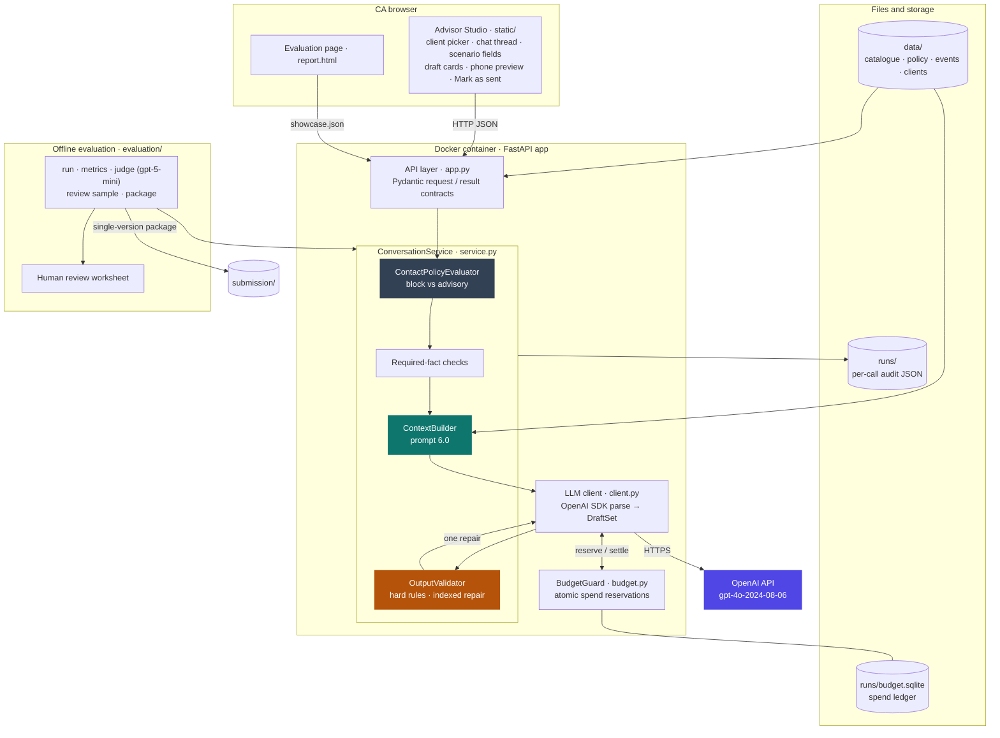
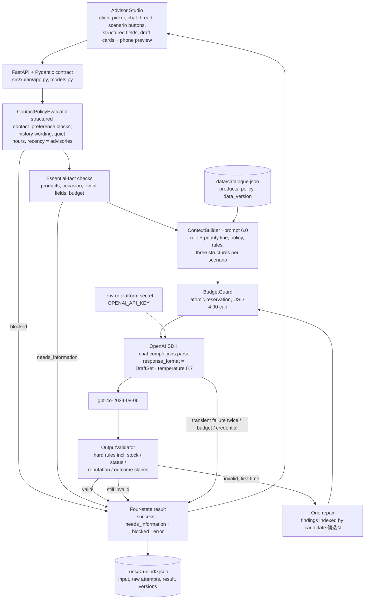
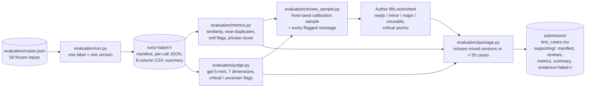

# Architecture

The system drafts three Chinese WeChat candidates for a Client Advisor (CA) and never sends anything itself. It has two parts:

- a **runtime path**: one CA request turned into three checked drafts, or a clear reason why none were produced;
- an **evaluation pipeline**: 50 frozen cases taken through generation, automated metrics, a model judge, sampled human review and the submission package.

## Versions

| Version | Prompt / data | Generation model | Judge model | Status |
|---|---|---|---|---|
| v5 | 5.0 / 1.1 | `gpt-4o-2024-08-06` | `gpt-5-mini-2025-08-07`, medium reasoning | Evaluated: single-version 50-case run, judge over all sets, 75 messages reviewed by the author |
| v6 | 6.0 / 1.2 | `gpt-4o-2024-08-06` | `gpt-5-mini-2025-08-07`, medium reasoning | **Submitted.** Single-version 50-case run, judge over all sets, 75 messages reviewed by the author |

v6 changes only what the v5 review asked for (see `defects_and_next_steps.md`):
- a role line and a priority line ("respond to the client's latest message");
- one fact rule, backed by a hard validator rule, against stock, sale-status, popularity/reputation and outcome claims;
- a reactivation rule for clients with no recorded interest;
- candidate-indexed repair feedback;
- removal of "Fictional" from the text the model sees.

## Components



## Runtime path



**Real vs test client.** The application and the evaluation scripts always use the real `OpenAIClient`. Tests inject `FakeLLMClient` from `tests/support.py`, which implements the same `LLMClient` protocol and replays scripted replies or exceptions; it is not part of the application package.

**Bounds.** The service owns two limits: at most one transient retry per call and at most one content repair. A single request therefore makes at most four model calls. The SDK's own retries are disabled. When a case still fails after repair it returns `error` with the findings, and no draft is invented.

**Blocking vs advisories.** Only the structured `contact_preference` field can block outreach. One exception: an opted-out client who asks a care question gets a service reply; a message that refuses contact or declines service never counts as such a question. Refusal-like wording in the conversation history is shown to the CA as an advisory, because keyword matching cannot reliably tell quoted, negated or superseded statements apart.

**Secrets.** Credentials are read in this order: `XULAN_ENV_FILE`, then the project `.env`, then `~/.env`. Variables already set in the environment take precedence, so a container platform can inject them from a secret manager. Credentials are checked for presence only; they are never printed, logged or exported.

## Evaluation pipeline



- **Single version.** `package.py` accepts only one label, one prompt/code/data version and all 50 cases. A case that fails stays in the CSV as a labelled error row and is never rerun on its own.
- **Judge vs author.** Usability is decided by the author's label where the author reviewed the message, and by the judge's scores otherwise. Agreement between the two is reported as raw counts on the calibration sample: agreement, false pass, false alarm and critical-flag agreement.
- **Human labels.** Only a human fills them. The code never pre-fills or defaults a label.

## Repository layout

```text
requirement.md        Authoritative specification (change record in section 15)
README.md             Setup, run, test and budget instructions
.env / .env.example   Local credential file (git-ignored) and its template
src/xulan/            app.py (FastAPI), models.py (API contracts), schemas.py (Pydantic output
                      contracts for SDK structured outputs), service.py (policy, context,
                      validator, repair loop), client.py (official OpenAI SDK), budget.py, pricing.py (pinned models
                      and rates), settings.py (credential loading), export.py, metrics.py, review.py
static/               Advisor Studio UI and the evaluation page (report.html + showcase.json)
data/                 catalogue.json (products, policy, data_version), events.json, clients.json
fixtures/             UI example requests
evaluation/           cases.json and the pipeline scripts above; abstention.py (35 zero-call
                      robustness cases) and reliability.py (latency, calls, cost)
tests/                Layered tests: unit/, integration/, system/ (HTTP, fake model),
                      acceptance/ (packaged submission), smoke/ (opt-in, running deployment)
runs/                 Runtime output: one folder per run label, per-call audit files and the
                      budget ledger (budget.sqlite). Not submitted; git-ignored.
submission/           Deliverables (INDEX.md, work_log.xlsx, methodology.md, test_cases.csv,
                      evaluation_report.md, defects_and_next_steps.md, architecture.md),
                      screenshots/, demo/, and supporting/ for the data behind the reports
archive/              Pre-v5 iterations (prompt 1.0–4.1) and withdrawn artifacts, unchanged;
                      archive/README.md maps each folder to its version, purpose and outcome
```

## Where state lives

| State | Location | Notes |
|---|---|---|
| Brand facts and policy | `data/catalogue.json` | Versioned by `data_version`. `brand_note` (fictional brand) is documentation only and is never sent to the model |
| Test inputs | `evaluation/cases.json` | Frozen; unchanged between versions |
| Per-call audit | `runs/<run_id>.json` (UI) or `runs/<label>/<run_id>.json` (batch) | Input, raw attempts, result, model, prompt/code/data versions; no secrets |
| Spend | `runs/budget.sqlite` | Atomic reservations settled to actual usage; unknown charges stay reserved |
| Human labels | `runs/<label>/author_review_worksheet.csv` | Copied into the submission at packaging |

## Deliberately out of scope

- Automatic sending or any WeChat connection.
- Authentication and multi-user use.
- Production deployment.

A container image and Cloud Run deployment are planned next steps and are not part of the current build. If deployed, they will need:
- access control, or a demo mode with no live generation;
- a spend ledger shared across instances, or a single instance;
- credentials from a secret manager.
