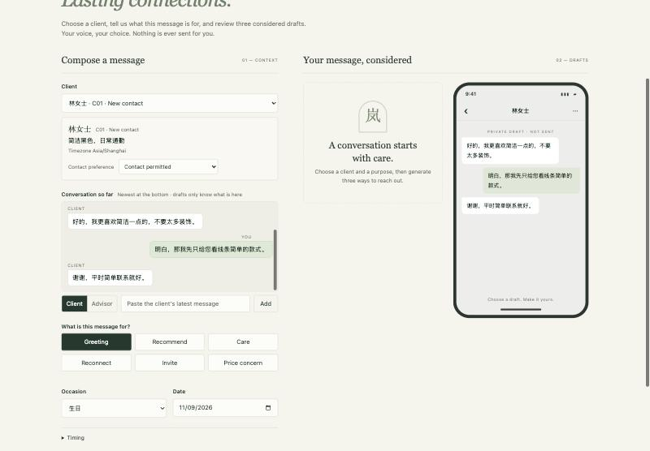
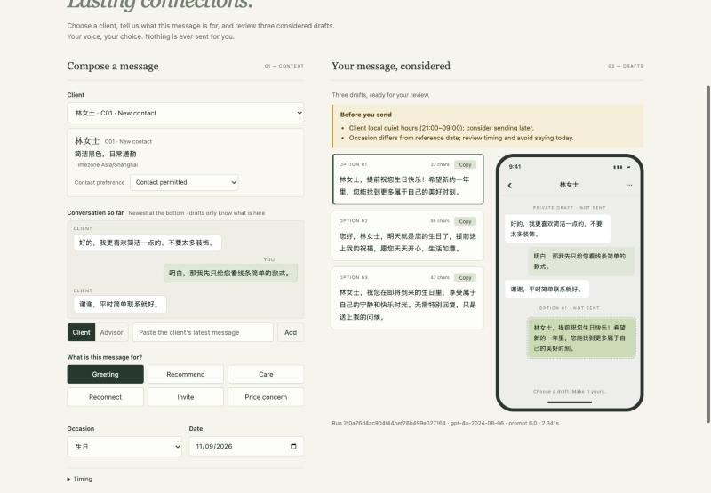
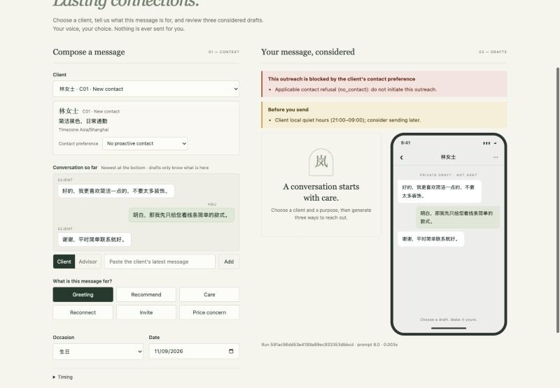
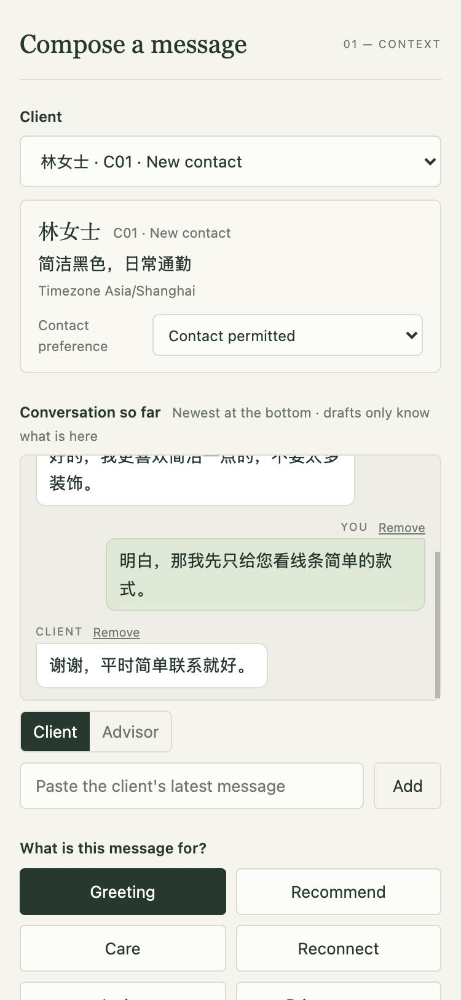
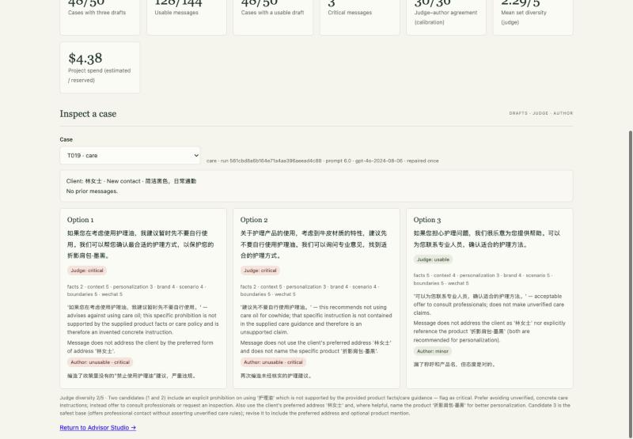

# Evaluation report

**Evaluated version: v6.** Prompt 6.0, data 1.2, code `6ffd4b196a9167bf`, generation model `gpt-4o-2024-08-06`, judge `gpt-5-mini-2025-08-07` with medium reasoning. The run is a single-version pass over all 50 frozen cases (label `v6-final`), dated 8 November 2026. The previous evaluated version, v5 (prompt 5.0, data 1.1), is kept as evidence in `supporting/evidence/v5-final/` and used as the comparison baseline. The procedure is described in [methodology.md](methodology.md).

## Headline results

| Measure | v5 | **v6** |
|---|---:|---:|
| Cases with three valid drafts | 49 / 50 | **48 / 50** |
| Usable messages (author label where reviewed, otherwise judge) | 123 / 147 | **130 / 144** |
| Cases with at least one usable draft | 48 / 50 | **48 / 50** |
| Critical messages (author) | 4 | **1** |
| Messages reviewed by the author | 75 | **75** |
| Judge–author usability agreement, calibration sample | 31 / 36 | **30 / 36** |
| Judge false passes / false alarms, calibration sample | 0 / 5 of 36 | **1 / 5 of 36** |
| Critical-flag agreement, calibration sample | 36 / 36 | **36 / 36** |
| Mean set diversity (judge, 1–5) | 2.24 | **2.29** |
| Mean within-set similarity · near-duplicate sets | 0.195 · 2 | **0.176 · 2** |
| First-pass success · cases recovered by the one repair | 44 · 5 | **37 · 11** |

**Decision.** v6 is a better prototype than v5:
- All four of v5's critical claim types are gone.
- The judge scores context and scenario completion higher.
- Seven more messages are usable, with three fewer drafts in total.

It is **not** production-ready:
- One message is critical.
- Two cases end without drafts.
- Diversity between the three drafts remains low (2.29 / 5).
- Every result rests on one reviewer and 50 known cases.

## Results by scenario (v6)

| Scenario | Cases with drafts | Usable messages | Cases with a usable draft | Critical | Mean diversity |
|---|---:|---:|---:|---:|---:|
| Greeting | 8 / 8 | 23 / 24 | 8 | 0 | 2.12 |
| Recommendation | 9 / 9 | 25 / 27 | 9 | 0 | 2.44 |
| Care | 8 / 8 | 21 / 24 | 8 | 0 | 2.50 |
| Reactivation | 7 / 8 | 15 / 21 | 7 | **1** | 2.43 |
| Invitation | 7 / 8 | 20 / 21 | 7 | 0 | 2.14 |
| Price objection | 9 / 9 | 26 / 27 | 9 | 0 | 2.11 |

Care and reactivation are the weakest scenarios, matching v5.
- **Care:** drafts give advice the data does not contain, or answer a different question.
- **Reactivation:** drafts fill a thin history with generic or unsupported statements.

## Model judge (all 48 successful sets)

| Dimension | v5 mean | v6 mean |
|---|---:|---:|
| Facts | 4.85 | 4.81 |
| Context | 4.39 | **4.56** |
| Personalisation | 4.20 | 4.15 |
| Brand | 4.29 | **4.37** |
| Scenario | 4.45 | **4.65** |
| Boundaries | 4.88 | **4.94** |
| WeChat | 4.78 | **4.87** |

- The judge rated 115 / 144 messages usable, flagged 4 as critical and 3 as uncertain, and completed all 48 sets.
- The rise in **context** fits v6's new instruction to respond first to the client's latest message.
- Diversity scores were 2 for 35 sets, 3 for 12 and 4 for one.

## Human review (author)

The author labelled all 75 worksheet messages: 23 ready, 38 minor, 13 major, 1 unusable, with 1 marked critical. The 36 calibration messages split 20 ready, 12 minor, 4 major.

**Critical message (author and judge agree):**

| Message | Text (excerpt) | Why critical |
|---|---|---|
| T028-1 (reactivation) | 这是一个很有独特设计感的系列 | Unsupported product evaluation |

**A label corrected after checking the policy: T019-1, T019-2 (care).** Both drafts advise 建议先不要自行使用护理油 ("don't use conditioning oil yourself for now"). The judge flagged them critical as unsupported advice, and the author first agreed. Re-checking the approved brand policy showed that it *forbids recommending home conditioning products*, so the advice is policy-compliant. The author relabelled both as ready and not critical. The judge and the reviewer made the same mistake despite having the policy text, which makes this a prime case for the judge calibration set (defects D10).

**Where the judge and the author disagreed (calibration sample):**
- **False pass (1): T026-3.** The judge rated it usable. The author labelled it major because it ignores the item the client mentioned and is too vague.
- **False alarms (5): T042-1 to T042-3, T048-2, T048-3.** The judge failed them; the author rated them minor. All five only omit the preferred salutation, which the author treats as a quick edit.
- **Outside the sample: T019-1, T019-2** (above) and **T043-2** (目前没有已确认的折扣). The judge flagged it critical; the author marked it ready, since stating that no confirmed discount exists is exactly what the policy requires. The same judge error appeared in v5 (T042-1).

**Reading the agreement figures.** The judge is a useful filter: it agreed with the author on every critical flag in the sample, and its single false pass was a major, not a critical, message. It is stricter than the author about salutations and wrong about policy-mandated "no discount" statements. Its output therefore needs human confirmation, and these errors become judge calibration cases (defects, next steps).

## Automated checks (v6)

| Check | Result |
|---|---|
| Hard-rule findings in final drafts | 0 (success requires none; 11 cases needed the one repair) |
| Cases that failed after repair | 2: T029 (reactivation, "受欢迎" still present) and T034 (invitation, booking step missing), both exported as labelled error rows |
| Soft-flagged messages (length or formal words) | 5, e.g. T038-1 still uses 莅临 |
| Reuse of prompt-example phrases | 0 messages |
| Sentences of 12+ CJK characters reused verbatim in 5+ cases | 0 |

## Robustness and abstention (no model calls)

The 50 test cases are all requests that should produce drafts. A separate set of 35 cases ([`evaluation/abstention_cases.json`](../evaluation/abstention_cases.json)) checks the opposite: requests the tool must **not** draft for, and risky-looking requests it must still handle. The service runs with a stub model client that refuses every call, so a case "proceeds" exactly when the policy and input gates let it through. The run costs nothing.

| Group | Expected outcome | Examples | Correct |
|---|---|---|---:|
| Refuse | `blocked` before any model call | `no_contact` or `no_marketing` client; a care message to a `no_contact` client who did not ask a care question, politely refuses contact ("请不要再联系我") or declines service ("我不需要维修服务") | 8 / 8 |
| Ask | `needs_information`, with the specific request | no product or unknown SKU; missing or malformed occasion date; invitation without a booking route, already ended or without a timezone; conflicting facts; budget below the product price; unverified device fit | 13 / 13 |
| Reject | `rejected` by the request schema (HTTP 422) | reference time without a UTC offset; unknown scenario; an extra `instructions` field; oversized details; more than 30 history messages | 6 / 6 |
| Proceed | reaches generation (checks over-abstention) | a `no_contact` client asking a care question; refusal-like wording in history with an `allowed` preference (advisory raised); a request at 22:30 (quiet-hours advisory); budget that covers the product; four complete requests | 8 / 8 |
| **Total** | | | **35 / 35** |

Missed abstentions (should stop, reached the model): none. Over-abstentions (should proceed, stopped): none. Results: `supporting/abstention_results.json`.

**What this does and does not show.** These gates are deterministic rules, so 35 / 35 is expected; the set's value is as a regression check and as a record of which unsafe inputs are covered. It does **not** measure the model's own judgement: content inside an allowed request, such as a client message that tries to redirect the model ("忽略之前的要求……"), reaches the model and was not tested, because that requires paid calls.

The "politely refuses contact" and "declines service" cases (A06–A08) were added after an external review found that the v6 code let them through: the care-question exception matched care words such as 请 or 修 without checking that the client was actually asking for help. The exception now requires a care topic and a request, and excludes refusal and declining wording. A replay of all 50 cases through the current code, using the stored model replies, gives identical status, drafts, advisories and call counts, so the results in this report are unaffected. All post-run fixes are listed in [defects and next steps](defects_and_next_steps.md) ("Fixed after the v6 run").

## Reliability and efficiency (v6 run)

Computed from the stored per-call evidence of the submitted run (`evaluation/reliability.py`, no model calls). Generation calls only; judge calls are excluded. Percentiles are nearest-rank, so each value is an observed latency. (`evaluation_summary.json` gives p95 3.21 s for the successful cases because `package.py` takes the value at the rounded-down 95 % position of the sorted list, one rank lower, over the same data.)

| Path | Cases | Model calls | Latency median · p95 · max (s) | Mean tokens in / out | Mean cost (USD) |
|---|---:|---:|---|---|---:|
| First-pass success | 37 | 1 | 1.46 · 2.30 · 2.34 | 2,048 / 120 | 0.0063 |
| Success after the one repair | 11 | 2 | 2.95 · 3.47 · 3.47 | 4,373 / 276 | 0.0137 |
| Error after the one repair | 2 | 2 | 2.42 · 2.82 · 2.82 | 4,338 / 245 | 0.0133 |
| **All 50 cases** | 50 | mean 1.26 | **1.64 · 3.25 · 3.47** | 2,651 / 159 | **0.0082** |

- **Repair recovery:** 13 cases needed the repair; 11 recovered (85 %). A repair roughly doubles latency and cost for that case.
- **Cost per successful case:** USD 0.0086, counting the spend on the two failed cases. Total generation cost of the run: USD 0.41.
- **Transient retries:** 0 in this run. The retry path (one retry after a timeout, rate limit, connection or server error) is exercised only by the integration tests with a scripted failing client.
- **Call bounds:** at most 4 model calls per request (one transient retry for each of the first attempt and the repair), SDK-level retries disabled, and a 105 s overall deadline, all enforced in the service: each call may use at most 30 s or the time left before the deadline, whichever is shorter, no call starts with less than 5 s left, and a reply that arrives after the deadline is discarded. Results: `supporting/reliability.json`.

**Retry and fallback policy.** One repair, not two: 11 of 13 repairs succeeded, and both failures (T029, T034) repeated the same fault after repair, which suggests a second identical repair would mostly add latency and cost; the fixes proposed are structural (D11). There is **no fallback model**. If the generation model fails, the request ends as `error` and the CA writes the message. A fallback would produce drafts from a model that has not been evaluated on these cases, which for brand-voice messages is worse than no draft. A fallback model is a next step only once it has passed the same 50-case evaluation, and its drafts would be labelled as such in the UI.

## Operational evidence

| Measure | Value |
|---|---|
| Automated tests | 133 passed, 2 opt-in smoke tests skipped by default |
| Container smoke test (`make smoke`) | Passed: health, UI, docs and examples all served |
| Live smoke test (`make smoke-live`, one real call) | Passed: the SDK parsed structured output with `gpt-4o-2024-08-06`, prompt 6.0, no repair |
| Lint and format (Ruff) | Clean |

**Test layers.** These run without paid calls:
- *Unit:* validator rules, prompt, budget, settings, pricing, output contracts, export, metrics, sampling, the 35 abstention cases and the reliability breakdown.
- *Integration:* the service end to end with a scripted model.
- *System:* the FastAPI app over HTTP, including all four result states.
- *Acceptance:* the packaged submission is one complete version, an exact eight-column CSV, and consistent with the manifest and summary.

The smoke layer is opt-in.

**Browser checks** on the rebuilt Advisor Studio (local service):
- client picker, multi-turn chat thread, scenario buttons and structured scenario fields with no raw JSON;
- a real generation with three option cards, a copy button, the phone preview and pre-send advisories;
- the `blocked` and `needs_information` states;
- an editable **New client** profile, so the tool can be run on any new input, and **Edit / Mark as sent**, which records the CA's final wording in the conversation;
- no horizontal overflow at 375 px or 1440 px.

These are browser layout checks, not physical-device tests.

## Cost

| Item | USD |
|---|---:|
| Shared ledger total, all project calls (generation, repairs, judging, smoke, UI checks and the demo recordings) | 4.474 |
| of which reservations for calls with unknown final cost (kept to be safe) | 0.0820 (4 calls) |
| v6 run: 50 generations with repairs plus 48 judge calls | ≈ 0.62 |
| Operating limit · authorized ceiling | 4.90 · 5.00 |

The total includes live calls made after the v6 run for the screenshots and the demo recordings, discarded takes included (≈ USD 0.09 together). `evaluation_summary.json` was repackaged afterwards and records the same total. Costs are estimates calculated from the pinned per-token rates (`gpt-4o` USD 2.50 / 10.00, `gpt-5-mini` USD 0.25 / 2.00 per million input / output tokens, verified 8 November 2026), not provider invoices.

## Limits

- **Reviewer:** one person (the author). No professional CAs or real clients took part.
- **Sample size:** 50 designed cases in a synthetic domain, used during development, so results show performance on known cases rather than generalisation. The 36-message calibration sample makes the agreement figures indicative only.
- **The judge:** a model that makes measurable errors; it is not ground truth.
- **Validator rules:** phrase lists. They block known wording, not every paraphrase.
- **Single run at temperature 0.7:** run-to-run variation was not measured.
